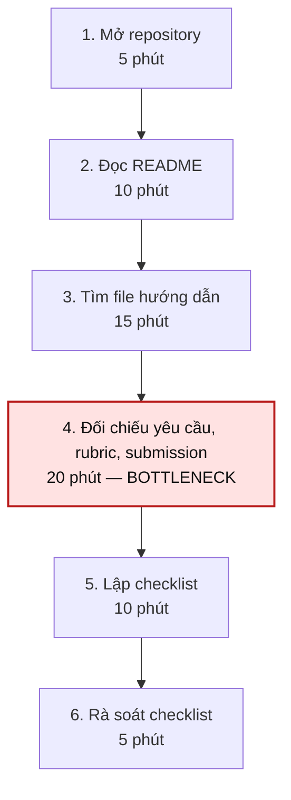
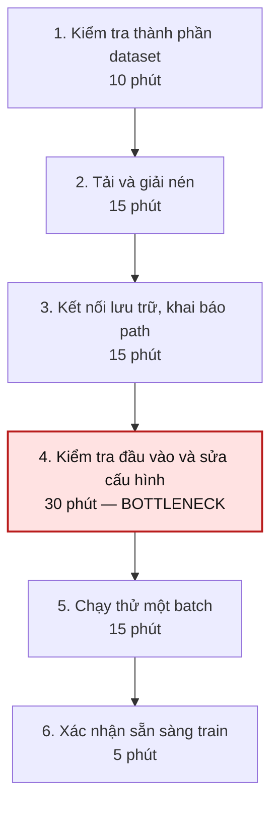
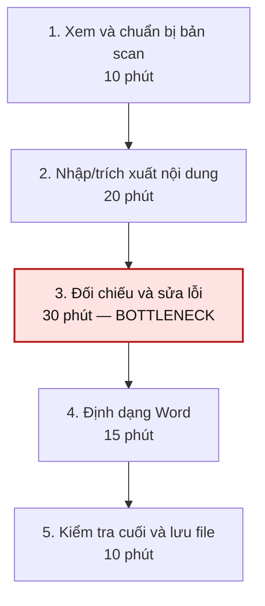

# Báo cáo cá nhân — 2A202604120_NguyenQuocQuangAnh
## 1. Thông tin học viên
- Họ tên: Nguyễn Quốc Quang Anh
- MSSV: 2A202604120
- Tên nhóm: Nhóm 12
- Link repo nhóm: https://github.com/WorkOfMinh/K5-L3B-DAY02-Nhom12-DiscoveryProblemFraming.git

---

## 2. Scan problem (CP1)

### 2.1. Phạm vi và cách tiếp cận

Phạm vi khám phá vấn đề tập trung vào việc học và thực hành của sinh viên Công nghệ thông tin: tiếp nhận yêu cầu từ repository, thiết lập môi trường lập trình, chuẩn bị dữ liệu nghiên cứu, xử lý tài liệu số, tổng hợp kết quả và phối hợp bài tập nhóm. Những hoạt động này có đầu vào, các bước thực hiện và sản phẩm đầu ra tương đối rõ, phù hợp để phân tích theo hướng **problem-first** thay vì bắt đầu bằng một ý tưởng AI.

Sáu vấn đề được mô tả dưới dạng **Job Story** theo bốn lăng kính: lặp lại, tốn thời gian, phải tổng hợp nhiều nguồn thông tin, và khó khăn phát sinh khi phối hợp. Phần *dấu hiệu* phân biệt hai loại thông tin: (a) dữ kiện có thể đối chiếu ngay từ tài liệu hoặc hiện vật; (b) thời gian **ước lượng dùng để hình thành giả thuyết**, không được hiểu là kết quả đo thực nghiệm hay phỏng vấn người dùng.

### 2.2. Bảng scan 6 vấn đề

| # | Lăng kính | Job Story: Khi… tôi muốn… để… | Ai chịu ảnh hưởng? | Dấu hiệu và phạm vi đo lường |
|---:|---|---|---|---|
| **P1** | Cần đọc, tổng hợp nhiều thông tin | Khi nhận một bài lab có yêu cầu nằm ở nhiều file trên GitHub, tôi muốn xác định đầy đủ nhiệm vụ, tiêu chí hoàn thành và file phải nộp, để tránh bỏ sót đầu việc hoặc đọc lại nhiều lần. | Sinh viên làm bài lab từ repository. | **Quan sát kiểm chứng được:** repo Day 02 công bố 8 checkpoint (CP0–CP7), tách hướng dẫn tại `README.md`, `CHECKPOINTS.md`, `RULES.md`, `RUBRIC.md`, `SUBMISSION.md` và `docs/01-worksheet.md`. **Mốc phân tích giả định:** 65 phút để tạo checklist yêu cầu từ đầu. |
| **P2** | Lặp lại | Khi chạy một dự án Python trong môi trường mới, tôi muốn thiết lập đúng phiên bản và thư viện, để chương trình chạy ổn định mà không phải sửa đi sửa lại lỗi cấu hình. | Sinh viên thực hành lập trình. | **Đầu ra kiểm tra được:** phiên bản Python, danh sách gói cài đặt, log lần chạy đầu và số lỗi trước khi chạy thành công. **Mốc phân tích giả định:** 60 phút/lần thiết lập. |
| **P3** | Tốn thời gian | Khi chuẩn bị chạy ResNet18 trên tập ảnh ISIC 2017 trong Google Colab, tôi muốn xác minh dữ liệu, nhãn và đường dẫn đã đúng, để không làm gián đoạn thí nghiệm vì lỗi chuẩn bị. | Sinh viên thực hành học máy. | **Đầu ra kiểm tra được:** cấu trúc thư mục ảnh, tệp nhãn, notebook và traceback nếu có. **Mốc phân tích giả định:** 90 phút cho toàn bộ khâu chuẩn bị/chạy thử, không tính train chính thức. |
| **P4** | Tốn thời gian | Khi có tài liệu PDF scan viết tay cần chuyển sang Word, tôi muốn giữ đúng nội dung gốc, để có bản văn bản chỉnh sửa được mà không phải nhập lại quá nhiều hoặc bỏ sót thông tin. | Sinh viên xử lý tài liệu học tập. | **Đầu ra kiểm tra được:** bản PDF nguồn và bản Word, số trang, số lỗi khi đối chiếu. **Mốc phân tích giả định:** 85 phút/tài liệu cùng độ dài. |
| **P5** | Cần đọc, tổng hợp nhiều thông tin | Khi hoàn thành thí nghiệm học máy, tôi muốn tập hợp đúng các chỉ số đánh giá từ kết quả chạy, để gửi báo cáo rõ ràng và không nhầm lẫn giữa các lần thí nghiệm. | Sinh viên thực hiện nghiên cứu AI. | **Các trường cần đối chiếu:** accuracy, precision, recall, F1-score; kèm tập đánh giá và phiên bản thí nghiệm. **Mốc phân tích giả định:** 70 phút/báo cáo. |
| **P6** | Pain từ người khác | Khi làm bài nhóm có nhiều đầu việc phụ thuộc nhau, tôi muốn biết nhiệm vụ nào đang được phụ trách và nhiệm vụ nào chưa hoàn tất, để hạn chế trùng công việc hoặc bỏ sót trước hạn nộp. | Thành viên nhóm học tập. | **Quan sát kiểm chứng được:** bài Day 02 quy định nhóm 3–4 người và có cả báo cáo cá nhân lẫn báo cáo nhóm. **Giả thuyết cần kiểm chứng với người thật:** việc đối chiếu tiến độ có thể mất 40 phút/tuần. |

**Diễn giải dấu hiệu:** Số lượng checkpoint, loại file và các trường dữ liệu là những đặc điểm của công việc, **không tự chứng minh** đã có người mất đúng thời gian hoặc từng gặp lỗi. Các mốc phút trong bảng là ước lượng để đặt câu hỏi, chọn hướng nghiên cứu và xây dựng metric; không phải số liệu phỏng vấn, khảo sát hay kết quả đo cá nhân. Khi chuyển sang CP4, nhóm phải kiểm chứng bằng hành vi và bằng chứng thực tế.

### 2.3. Nhận xét và lựa chọn sơ bộ

- **P1** nổi bật ở việc thông tin phân tán và cần đối chiếu nhiều tài liệu. Đây là vấn đề có phạm vi nhỏ: từ khi nhận link repo đến khi lập xong checklist các yêu cầu bắt buộc. Dễ phân biệt giữa việc *đọc được nội dung* và *xác định đúng việc cần làm*.
- **P2** và **P3** cùng liên quan đến lỗi kỹ thuật, nhưng P3 cụ thể hơn vì giới hạn trong chuẩn bị dữ liệu và notebook cho một thí nghiệm.
- **P4** khác với việc chỉ rút ngắn thời gian thao tác: chất lượng nội dung sau chuyển đổi phải được giữ ổn định, nếu không giải pháp có thể gây hại hơn lợi.
- **P5** có nguy cơ trộn số liệu từ train, validation và test hoặc từ nhiều lần chạy; điều này phù hợp với một quy trình kiểm tra và chuẩn hóa báo cáo.
- **P6** liên quan đến nhiều thành viên nhưng cần tín hiệu từ chính người tham gia để xác định mức độ thường xuyên và hậu quả của vấn đề, không suy ra từ quy định làm việc nhóm.

Từ các tiêu chí **actor rõ**, **quy trình vẽ được**, **bottleneck cụ thể**, **tác động đo được** và **phạm vi vừa sức**, ba ứng viên được đưa vào CP2 là **P1, P3 và P4**. Đây là quyết định chọn vấn đề để phân tích sâu, **chưa phải quyết định triển khai AI**.

### 2.4. Vai trò của AI trong bước scan

ChatGPT được dùng để rà soát cách diễn đạt, kiểm tra xem Job Story đã nói về khó khăn của người dùng hay đang mô tả sẵn giải pháp, đồng thời nêu các lỗ hổng trong bằng chứng. Các gợi ý được xử lý như sau:

| Gợi ý được xem xét | Xử lý | Lý do |
|---|---|---|
| Tách việc đọc nhiều file và việc đối chiếu yêu cầu của bài lab | Giữ | Hai hoạt động có thể có thời gian và nguyên nhân chậm khác nhau. |
| Giới hạn vấn đề Colab ở chuẩn bị và kiểm tra đầu vào, không gộp cả quá trình nghiên cứu mô hình | Giữ | Làm rõ phạm vi, bottleneck và cách đo. |
| Tạo một trợ lý AI tự làm toàn bộ bài tập, lập trình và nộp bài | Loại | Đây là solution quá rộng, chưa chỉ ra pain thực tế hay giới hạn trách nhiệm. |

**Kết luận CP1:** Có sáu candidate problem theo bốn lăng kính; ba candidate được chuyển sang CP2. Các con số thời gian chỉ là giả định phân tích, còn các nhận định về tần suất và mức độ ảnh hưởng cần được kiểm chứng bằng hành vi thật ở bước nghiên cứu tiếp theo.

---

## 3. Top 3 Problem Cards + quy trình nháp (CP2)

### 3.1. Bảng chọn top 3

| Rank | Problem | Vì sao chọn | Điều còn chưa chắc |
|---:|---|---|---|
| **1** | **P1 — Xác định yêu cầu bài lab từ nhiều file GitHub** | Actor cụ thể, quy trình bắt đầu/kết thúc rõ, dễ kiểm tra với repo thật; có thể so sánh hiệu quả checklist với cách đọc thủ công. | Bước nghẽn là tìm file, hiểu câu chữ hay đối chiếu yêu cầu bắt buộc? |
| **2** | **P3 — Chuẩn bị dữ liệu và notebook ResNet18 trên Colab** | Tác vụ kỹ thuật có log và đầu ra rõ; bottleneck có thể cô lập ở khâu cấu hình trước train. | Lỗi xuất hiện do đường dẫn, tập dữ liệu, dependency hay thao tác người dùng? |
| **3** | **P4 — Chuyển PDF scan viết tay sang Word** | Có đầu vào và đầu ra so sánh được; metric cần phản ánh cả thời gian lẫn độ trung thực của nội dung. | Khâu nhập nội dung hay khâu rà soát bản Word mới thực sự mất thời gian nhất? |

**Quy ước thống nhất:** Toàn bộ thời gian ở ba sơ đồ dưới đây là một **kịch bản ước lượng tham chiếu** cho mỗi lần thực hiện công việc, không phải dữ liệu đã đo; mỗi tổng được tính từ thời gian từng bước. **Baseline** là mốc giả định để thiết kế cách đánh giá; **target** là mục tiêu đề xuất, không phải kết quả cải thiện đã đạt.

### 3.2. Problem Card #1 — Xác định đầy đủ yêu cầu bài lab GitHub

| Trường | Nội dung |
|---|---|
| **Job Story** | Khi nhận một bài lab có yêu cầu nằm trong nhiều file GitHub, tôi muốn xác định đúng các nhiệm vụ, file phải hoàn thành và tiêu chí chấm, để lập kế hoạch thực hiện không bỏ sót việc. |
| **Actor** | Sinh viên CNTT vừa nhận repository hướng dẫn bài lab. |
| **Thời điểm / bối cảnh** | Từ khi mở link repository đến khi có checklist công việc trước khi bắt đầu bài. |
| **Quy trình hiện tại (6 bước)** | (1) Mở repository; (2) đọc `README.md`; (3) tìm các file hướng dẫn liên quan; (4) đối chiếu checkpoint, rubric, submission; (5) ghi checklist; (6) rà soát checklist với nguồn gốc. |
| **Bottleneck** | **Bước 4 — đối chiếu yêu cầu giữa các file: 20 phút/lần (ước lượng)**. Đòi hỏi phân biệt tài liệu tham khảo với đầu ra bắt buộc và điều kiện chấm. |
| **Impact** | Mất thời gian đọc lại tài liệu; có nguy cơ bỏ sót mục bắt buộc hoặc sửa sai file; ảnh hưởng tiến độ và chất lượng nộp bài. |
| **Success metric (baseline → target)** | **Thời gian lập checklist:** 65 → 30 phút/lần (**giả định → mục tiêu**). **Độ bao phủ yêu cầu:** mục tiêu 100% yêu cầu bắt buộc được liệt kê và gắn đúng file. **Cách đo:** bấm giờ từ khi mở repo đến khi checklist hoàn tất; đối chiếu checklist với `CHECKPOINTS.md`, `RUBRIC.md`, `SUBMISSION.md`. |
| **Phương án không dùng AI** | Checklist theo checkpoint và mapping `yêu cầu → tài liệu nguồn → file đầu ra → trạng thái`, liên kết trực tiếp đến vị trí hướng dẫn. |
| **Giả thuyết về AI (nếu có)** | AI có thể hỗ trợ soạn checklist sơ bộ từ tài liệu, nhưng sinh viên phải xác minh từng yêu cầu bằng file nguồn; không tự tạo nội dung bài hay tự nộp. |
| **Cảm nhận nhanh** | **Rule hoặc Workflow, chưa chốt.** Thử checklist có cấu trúc trước, vì có thể đủ giải quyết phần lớn khó khăn. |

**Quy trình nháp hiện tại — tổng 65 phút/lần (ước lượng):**

**Lý do chọn bước nghẽn:** Đọc được từng file không đồng nghĩa đã biết chính xác phải nộp gì. Bước 4 là điểm kết nối các yêu cầu phân tán thành một bộ nhiệm vụ hoàn chỉnh; nếu đối chiếu sai, checklist tạo ở bước sau cũng sai. **Boundary của vấn đề:** chỉ xét việc xác định yêu cầu, không xét việc tự hoàn thành bài bằng công cụ.

### 3.3. Problem Card #2 — Chuẩn bị thí nghiệm ResNet18 trên Google Colab

| Trường | Nội dung |
|---|---|
| **Job Story** | Khi chuẩn bị chạy ResNet18 với dữ liệu ISIC 2017 trên Colab, tôi muốn kiểm tra chính xác cấu trúc dữ liệu, đường dẫn và thiết lập môi trường, để thí nghiệm không bị gián đoạn vì lỗi đầu vào. |
| **Actor** | Sinh viên thực hành huấn luyện mô hình phân loại ảnh trong notebook Colab. |
| **Thời điểm / bối cảnh** | Sau khi có dữ liệu và trước khi bắt đầu huấn luyện đầy đủ. |
| **Quy trình hiện tại (6 bước)** | (1) Kiểm tra các thành phần dataset; (2) tải/giải nén; (3) kết nối nơi lưu trữ và khai báo đường dẫn; (4) kiểm tra ảnh/nhãn, sửa lỗi cấu hình; (5) chạy thử một batch; (6) xác nhận trạng thái sẵn sàng train. |
| **Bottleneck** | **Bước 4 — kiểm tra dữ liệu và sửa lỗi cấu hình: 30 phút/lần (ước lượng)**. Lỗi đường dẫn hoặc không khớp file ảnh/nhãn có thể khiến quy trình dừng. |
| **Impact** | Tăng thời gian chuẩn bị, phải chạy lại notebook; rủi ro sử dụng nhầm đường dẫn hoặc đầu vào không đúng, làm thí nghiệm thiếu tin cậy. |
| **Success metric (baseline → target)** | **Thời gian chuẩn bị và chạy thử:** 90 → 45 phút/lần (**giả định → mục tiêu**), **không bao gồm thời gian train chính thức**. Mục tiêu 0 lỗi cấu trúc/đường dẫn ở lần chạy preflight. **Cách đo:** ghi thời điểm bắt đầu/kết thúc khâu chuẩn bị và đếm lỗi trước khi train. |
| **Phương án không dùng AI** | Notebook mẫu, cấu trúc thư mục thống nhất, cấu hình tập trung, checklist preflight kiểm tra file ảnh/nhãn, split và một batch dữ liệu. |
| **Giả thuyết về AI (nếu có)** | AI giúp diễn giải traceback hoặc gợi ý bước kiểm tra; người dùng xác nhận mọi thay đổi và không để AI tự chạy huấn luyện hoặc xử lý file dữ liệu ngoài phạm vi. |
| **Cảm nhận nhanh** | **Rule** có thể đủ dùng: mã kiểm tra đầu vào tự động trước train. |

**Quy trình nháp hiện tại — tổng 90 phút/lần chuẩn bị (ước lượng):**

**Lý do chọn bước nghẽn:** Một lỗi dữ liệu/cấu hình trước khi train không thể giải quyết bằng việc thay kiến trúc ResNet18. Vì vậy nhiệm vụ cần thu hẹp vào **preflight của notebook**, không đồng nhất với bài toán nâng accuracy, cũng không lấy thời gian GPU train làm thời gian thao tác của người dùng.

### 3.4. Problem Card #3 — Chuyển PDF scan viết tay sang Word mà vẫn đúng nội dung

| Trường | Nội dung |
|---|---|
| **Job Story** | Khi có tài liệu viết tay dưới dạng PDF scan cần chỉnh sửa trong Word, tôi muốn chuyển đổi mà vẫn giữ chính xác nội dung gốc, để giảm nhập lại thủ công và dùng được tài liệu cho học tập. |
| **Actor** | Sinh viên cần chuyển tài liệu scan để soát lỗi, chỉnh sửa hoặc trích xuất nội dung. |
| **Thời điểm / bối cảnh** | Từ lúc có bản PDF scan đến khi tạo xong bản Word đã kiểm tra. |
| **Quy trình hiện tại (5 bước)** | (1) Kiểm tra chất lượng scan; (2) nhập hoặc trích xuất nội dung; (3) đối chiếu và sửa lỗi; (4) định dạng Word; (5) kiểm tra cuối và lưu file. |
| **Bottleneck** | **Bước 3 — đối chiếu và sửa lỗi chữ viết tay: 30 phút/tài liệu (ước lượng)**, nhất là từ khó đọc, con số và ký hiệu. |
| **Impact** | Mất công nhập liệu; lỗi nội dung có thể gây sai lệch khi phân tích; phải rà soát nhiều vòng trước khi sử dụng. |
| **Success metric (baseline → target)** | **Thời gian hoàn tất một tài liệu cùng số trang:** 85 → 45 phút (**giả định → mục tiêu**). **Chất lượng:** mục tiêu tỷ lệ từ sai sau kiểm tra ≤2% trên mẫu so khớp với bản gốc. **Cách đo:** bấm giờ, đếm số từ sai chia cho tổng số từ được kiểm tra, giữ nguyên tài liệu mẫu. |
| **Phương án không dùng AI** | Nhập tay theo từng trang; đánh dấu vị trí khó đọc; checklist soát số, tên riêng, ký hiệu và đoạn bỏ sót; kiểm tra lại với bản gốc. |
| **Giả thuyết về AI (nếu có)** | Nhận dạng chữ viết tay tạo bản nháp, sau đó người dùng kiểm tra thủ công và phê duyệt; các đoạn mơ hồ phải được đánh dấu, không tự đoán nội dung. |
| **Cảm nhận nhanh** | **Workflow có người soát**, chỉ cân nhắc sau khi so với phương án thủ công hoặc công cụ nhận dạng có sẵn. |

**Quy trình nháp hiện tại — tổng 85 phút/tài liệu (ước lượng):**

**Lý do chọn bước nghẽn:** Khả năng chỉnh sửa văn bản không có ý nghĩa nếu tài liệu sau chuyển đổi sai so với bản gốc. Vì thế bottleneck được đặt ở đối chiếu, và metric phải gồm **độ chính xác** chứ không chỉ thời gian. Phạm vi không bao gồm tự diễn giải hoặc viết lại nội dung tác giả.

### 3.5. Card muốn pitch nhất

- **Card số:** **#1 — Xác định yêu cầu bài lab từ nhiều file GitHub.**
- **Vì sao chọn:** Có actor và thời điểm rõ, có thể kiểm tra trực tiếp trên một repo công khai và đánh giá checklist theo hai chỉ số độc lập: thời gian tạo và độ bao phủ yêu cầu. Chi phí kiểm chứng thấp, đồng thời có phương án No AI đủ mạnh để so sánh trước khi tăng mức tự động hóa.
- **Câu hỏi muốn nhóm phản biện:** **“Nếu checklist chuẩn kèm liên kết đến các file gốc đã giúp sinh viên xác định đủ yêu cầu, bước nào vẫn thật sự cần can thiệp bằng AI?”**

### 3.6. AI đã phản biện card thế nào?

**Công cụ:** ChatGPT. **Vai trò phản biện:** Product Manager hoài nghi. **Trọng tâm:** Tính cụ thể của actor, tính thực tế của bước nghẽn, sự nhất quán của metric và khả năng giải quyết không cần AI. Đây là phần ghi nhận phản biện đối với **bản phân tích**, không thay cho khảo sát hay phỏng vấn người dùng.

**Prompt phản biện đã dùng để xây dựng bản chỉnh lý:**

> Hãy đóng vai Product Manager hoài nghi. Với ba Problem Card về (1) đọc yêu cầu lab GitHub, (2) chuẩn bị dữ liệu/Colab trước khi train ResNet18 và (3) chuyển PDF scan viết tay sang Word, hãy tìm lỗ hổng trong actor, quy trình, bottleneck, tác động, baseline, target, cách đo và phương án không dùng AI. Chỉ nêu điểm yếu; không tự tạo người dùng hoặc số liệu đo đạc.

| Điểm yếu AI chỉ ra | Đồng ý? | Đã sửa gì trong bản này |
|---|---|---|
| Dùng số phút ước lượng như dữ liệu thực đo sẽ tạo bằng chứng không trung thực. | Có | Thống nhất nhãn **giả định → mục tiêu**, nêu rõ cách đo và không tuyên bố đã đạt target. |
| Card #1 dễ gộp việc đọc file với việc đối chiếu yêu cầu giữa nhiều nguồn. | Có | Tách bước tìm tài liệu (**bước 3**) và bước đối chiếu (**bước 4**); xác định bước 4 là bottleneck giả định. |
| Card #2 có thể tính nhầm cả thời gian huấn luyện GPU vào pain của người chuẩn bị. | Có | Giới hạn baseline/target ở **khâu chuẩn bị và chạy thử**. |
| Card #3 chỉ rút ngắn thời gian mà không kiểm soát lỗi là success metric chưa đầy đủ. | Có | Bổ sung tỷ lệ từ sai ≤2% sau kiểm tra trên mẫu cố định. |
| Việc đề xuất AI sớm có thể che khuất giải pháp đơn giản hơn. | Có | Nêu phương án **No AI** cho cả ba, chỉ để AI ở dạng giả thuyết và chưa chọn Agent. |

**Đánh giá sau phản biện:** Các card đã tách rõ nhu cầu, quy trình, bottleneck, tác động, thước đo và giải pháp không dùng AI. Điều chỉnh đáng kể nhất là chuyển **bước đối chiếu yêu cầu** thành bottleneck giả định của P1, thay vì gọi chung việc “đọc GitHub” là bước chậm; đồng thời bổ sung ràng buộc chất lượng cho P4.## 2. Scan problem (CP1)

### 2.1. Phạm vi và cách tiếp cận

Phạm vi khám phá vấn đề tập trung vào việc học và thực hành của sinh viên Công nghệ thông tin: tiếp nhận yêu cầu từ repository, thiết lập môi trường lập trình, chuẩn bị dữ liệu nghiên cứu, xử lý tài liệu số, tổng hợp kết quả và phối hợp bài tập nhóm. Những hoạt động này có đầu vào, các bước thực hiện và sản phẩm đầu ra tương đối rõ, phù hợp để phân tích theo hướng **problem-first** thay vì bắt đầu bằng một ý tưởng AI.

Sáu vấn đề được mô tả dưới dạng **Job Story** theo bốn lăng kính: lặp lại, tốn thời gian, phải tổng hợp nhiều nguồn thông tin, và khó khăn phát sinh khi phối hợp. Phần *dấu hiệu* phân biệt hai loại thông tin: (a) dữ kiện có thể đối chiếu ngay từ tài liệu hoặc hiện vật; (b) thời gian **ước lượng dùng để hình thành giả thuyết**, không được hiểu là kết quả đo thực nghiệm hay phỏng vấn người dùng.

### 2.2. Bảng scan 6 vấn đề

| # | Lăng kính | Job Story: Khi… tôi muốn… để… | Ai chịu ảnh hưởng? | Dấu hiệu và phạm vi đo lường |
|---:|---|---|---|---|
| **P1** | Cần đọc, tổng hợp nhiều thông tin | Khi nhận một bài lab có yêu cầu nằm ở nhiều file trên GitHub, tôi muốn xác định đầy đủ nhiệm vụ, tiêu chí hoàn thành và file phải nộp, để tránh bỏ sót đầu việc hoặc đọc lại nhiều lần. | Sinh viên làm bài lab từ repository. | **Quan sát kiểm chứng được:** repo Day 02 công bố 8 checkpoint (CP0–CP7), tách hướng dẫn tại `README.md`, `CHECKPOINTS.md`, `RULES.md`, `RUBRIC.md`, `SUBMISSION.md` và `docs/01-worksheet.md`. **Mốc phân tích giả định:** 65 phút để tạo checklist yêu cầu từ đầu. |
| **P2** | Lặp lại | Khi chạy một dự án Python trong môi trường mới, tôi muốn thiết lập đúng phiên bản và thư viện, để chương trình chạy ổn định mà không phải sửa đi sửa lại lỗi cấu hình. | Sinh viên thực hành lập trình. | **Đầu ra kiểm tra được:** phiên bản Python, danh sách gói cài đặt, log lần chạy đầu và số lỗi trước khi chạy thành công. **Mốc phân tích giả định:** 60 phút/lần thiết lập. |
| **P3** | Tốn thời gian | Khi chuẩn bị chạy ResNet18 trên tập ảnh ISIC 2017 trong Google Colab, tôi muốn xác minh dữ liệu, nhãn và đường dẫn đã đúng, để không làm gián đoạn thí nghiệm vì lỗi chuẩn bị. | Sinh viên thực hành học máy. | **Đầu ra kiểm tra được:** cấu trúc thư mục ảnh, tệp nhãn, notebook và traceback nếu có. **Mốc phân tích giả định:** 90 phút cho toàn bộ khâu chuẩn bị/chạy thử, không tính train chính thức. |
| **P4** | Tốn thời gian | Khi có tài liệu PDF scan viết tay cần chuyển sang Word, tôi muốn giữ đúng nội dung gốc, để có bản văn bản chỉnh sửa được mà không phải nhập lại quá nhiều hoặc bỏ sót thông tin. | Sinh viên xử lý tài liệu học tập. | **Đầu ra kiểm tra được:** bản PDF nguồn và bản Word, số trang, số lỗi khi đối chiếu. **Mốc phân tích giả định:** 85 phút/tài liệu cùng độ dài. |
| **P5** | Cần đọc, tổng hợp nhiều thông tin | Khi hoàn thành thí nghiệm học máy, tôi muốn tập hợp đúng các chỉ số đánh giá từ kết quả chạy, để gửi báo cáo rõ ràng và không nhầm lẫn giữa các lần thí nghiệm. | Sinh viên thực hiện nghiên cứu AI. | **Các trường cần đối chiếu:** accuracy, precision, recall, F1-score; kèm tập đánh giá và phiên bản thí nghiệm. **Mốc phân tích giả định:** 70 phút/báo cáo. |
| **P6** | Pain từ người khác | Khi làm bài nhóm có nhiều đầu việc phụ thuộc nhau, tôi muốn biết nhiệm vụ nào đang được phụ trách và nhiệm vụ nào chưa hoàn tất, để hạn chế trùng công việc hoặc bỏ sót trước hạn nộp. | Thành viên nhóm học tập. | **Quan sát kiểm chứng được:** bài Day 02 quy định nhóm 3–4 người và có cả báo cáo cá nhân lẫn báo cáo nhóm. **Giả thuyết cần kiểm chứng với người thật:** việc đối chiếu tiến độ có thể mất 40 phút/tuần. |

**Diễn giải dấu hiệu:** Số lượng checkpoint, loại file và các trường dữ liệu là những đặc điểm của công việc, **không tự chứng minh** đã có người mất đúng thời gian hoặc từng gặp lỗi. Các mốc phút trong bảng là ước lượng để đặt câu hỏi, chọn hướng nghiên cứu và xây dựng metric; không phải số liệu phỏng vấn, khảo sát hay kết quả đo cá nhân. Khi chuyển sang CP4, nhóm phải kiểm chứng bằng hành vi và bằng chứng thực tế.

### 2.3. Nhận xét và lựa chọn sơ bộ

- **P1** nổi bật ở việc thông tin phân tán và cần đối chiếu nhiều tài liệu. Đây là vấn đề có phạm vi nhỏ: từ khi nhận link repo đến khi lập xong checklist các yêu cầu bắt buộc. Dễ phân biệt giữa việc *đọc được nội dung* và *xác định đúng việc cần làm*.
- **P2** và **P3** cùng liên quan đến lỗi kỹ thuật, nhưng P3 cụ thể hơn vì giới hạn trong chuẩn bị dữ liệu và notebook cho một thí nghiệm.
- **P4** khác với việc chỉ rút ngắn thời gian thao tác: chất lượng nội dung sau chuyển đổi phải được giữ ổn định, nếu không giải pháp có thể gây hại hơn lợi.
- **P5** có nguy cơ trộn số liệu từ train, validation và test hoặc từ nhiều lần chạy; điều này phù hợp với một quy trình kiểm tra và chuẩn hóa báo cáo.
- **P6** liên quan đến nhiều thành viên nhưng cần tín hiệu từ chính người tham gia để xác định mức độ thường xuyên và hậu quả của vấn đề, không suy ra từ quy định làm việc nhóm.

Từ các tiêu chí **actor rõ**, **quy trình vẽ được**, **bottleneck cụ thể**, **tác động đo được** và **phạm vi vừa sức**, ba ứng viên được đưa vào CP2 là **P1, P3 và P4**. Đây là quyết định chọn vấn đề để phân tích sâu, **chưa phải quyết định triển khai AI**.

### 2.4. Vai trò của AI trong bước scan

ChatGPT được dùng để rà soát cách diễn đạt, kiểm tra xem Job Story đã nói về khó khăn của người dùng hay đang mô tả sẵn giải pháp, đồng thời nêu các lỗ hổng trong bằng chứng. Các gợi ý được xử lý như sau:

| Gợi ý được xem xét | Xử lý | Lý do |
|---|---|---|
| Tách việc đọc nhiều file và việc đối chiếu yêu cầu của bài lab | Giữ | Hai hoạt động có thể có thời gian và nguyên nhân chậm khác nhau. |
| Giới hạn vấn đề Colab ở chuẩn bị và kiểm tra đầu vào, không gộp cả quá trình nghiên cứu mô hình | Giữ | Làm rõ phạm vi, bottleneck và cách đo. |
| Tạo một trợ lý AI tự làm toàn bộ bài tập, lập trình và nộp bài | Loại | Đây là solution quá rộng, chưa chỉ ra pain thực tế hay giới hạn trách nhiệm. |

**Kết luận CP1:** Có sáu candidate problem theo bốn lăng kính; ba candidate được chuyển sang CP2. Các con số thời gian chỉ là giả định phân tích, còn các nhận định về tần suất và mức độ ảnh hưởng cần được kiểm chứng bằng hành vi thật ở bước nghiên cứu tiếp theo.

---

## 3. Top 3 Problem Cards + quy trình nháp (CP2)

### 3.1. Bảng chọn top 3

| Rank | Problem | Vì sao chọn | Điều còn chưa chắc |
|---:|---|---|---|
| **1** | **P1 — Xác định yêu cầu bài lab từ nhiều file GitHub** | Actor cụ thể, quy trình bắt đầu/kết thúc rõ, dễ kiểm tra với repo thật; có thể so sánh hiệu quả checklist với cách đọc thủ công. | Bước nghẽn là tìm file, hiểu câu chữ hay đối chiếu yêu cầu bắt buộc? |
| **2** | **P3 — Chuẩn bị dữ liệu và notebook ResNet18 trên Colab** | Tác vụ kỹ thuật có log và đầu ra rõ; bottleneck có thể cô lập ở khâu cấu hình trước train. | Lỗi xuất hiện do đường dẫn, tập dữ liệu, dependency hay thao tác người dùng? |
| **3** | **P4 — Chuyển PDF scan viết tay sang Word** | Có đầu vào và đầu ra so sánh được; metric cần phản ánh cả thời gian lẫn độ trung thực của nội dung. | Khâu nhập nội dung hay khâu rà soát bản Word mới thực sự mất thời gian nhất? |

**Quy ước thống nhất:** Toàn bộ thời gian ở ba sơ đồ dưới đây là một **kịch bản ước lượng tham chiếu** cho mỗi lần thực hiện công việc, không phải dữ liệu đã đo; mỗi tổng được tính từ thời gian từng bước. **Baseline** là mốc giả định để thiết kế cách đánh giá; **target** là mục tiêu đề xuất, không phải kết quả cải thiện đã đạt.

### 3.2. Problem Card #1 — Xác định đầy đủ yêu cầu bài lab GitHub

| Trường | Nội dung |
|---|---|
| **Job Story** | Khi nhận một bài lab có yêu cầu nằm trong nhiều file GitHub, tôi muốn xác định đúng các nhiệm vụ, file phải hoàn thành và tiêu chí chấm, để lập kế hoạch thực hiện không bỏ sót việc. |
| **Actor** | Sinh viên CNTT vừa nhận repository hướng dẫn bài lab. |
| **Thời điểm / bối cảnh** | Từ khi mở link repository đến khi có checklist công việc trước khi bắt đầu bài. |
| **Quy trình hiện tại (6 bước)** | (1) Mở repository; (2) đọc `README.md`; (3) tìm các file hướng dẫn liên quan; (4) đối chiếu checkpoint, rubric, submission; (5) ghi checklist; (6) rà soát checklist với nguồn gốc. |
| **Bottleneck** | **Bước 4 — đối chiếu yêu cầu giữa các file: 20 phút/lần (ước lượng)**. Đòi hỏi phân biệt tài liệu tham khảo với đầu ra bắt buộc và điều kiện chấm. |
| **Impact** | Mất thời gian đọc lại tài liệu; có nguy cơ bỏ sót mục bắt buộc hoặc sửa sai file; ảnh hưởng tiến độ và chất lượng nộp bài. |
| **Success metric (baseline → target)** | **Thời gian lập checklist:** 65 → 30 phút/lần (**giả định → mục tiêu**). **Độ bao phủ yêu cầu:** mục tiêu 100% yêu cầu bắt buộc được liệt kê và gắn đúng file. **Cách đo:** bấm giờ từ khi mở repo đến khi checklist hoàn tất; đối chiếu checklist với `CHECKPOINTS.md`, `RUBRIC.md`, `SUBMISSION.md`. |
| **Phương án không dùng AI** | Checklist theo checkpoint và mapping `yêu cầu → tài liệu nguồn → file đầu ra → trạng thái`, liên kết trực tiếp đến vị trí hướng dẫn. |
| **Giả thuyết về AI (nếu có)** | AI có thể hỗ trợ soạn checklist sơ bộ từ tài liệu, nhưng sinh viên phải xác minh từng yêu cầu bằng file nguồn; không tự tạo nội dung bài hay tự nộp. |
| **Cảm nhận nhanh** | **Rule hoặc Workflow, chưa chốt.** Thử checklist có cấu trúc trước, vì có thể đủ giải quyết phần lớn khó khăn. |

**Quy trình nháp hiện tại — tổng 65 phút/lần (ước lượng):**

**Lý do chọn bước nghẽn:** Đọc được từng file không đồng nghĩa đã biết chính xác phải nộp gì. Bước 4 là điểm kết nối các yêu cầu phân tán thành một bộ nhiệm vụ hoàn chỉnh; nếu đối chiếu sai, checklist tạo ở bước sau cũng sai. **Boundary của vấn đề:** chỉ xét việc xác định yêu cầu, không xét việc tự hoàn thành bài bằng công cụ.

### 3.3. Problem Card #2 — Chuẩn bị thí nghiệm ResNet18 trên Google Colab

| Trường | Nội dung |
|---|---|
| **Job Story** | Khi chuẩn bị chạy ResNet18 với dữ liệu ISIC 2017 trên Colab, tôi muốn kiểm tra chính xác cấu trúc dữ liệu, đường dẫn và thiết lập môi trường, để thí nghiệm không bị gián đoạn vì lỗi đầu vào. |
| **Actor** | Sinh viên thực hành huấn luyện mô hình phân loại ảnh trong notebook Colab. |
| **Thời điểm / bối cảnh** | Sau khi có dữ liệu và trước khi bắt đầu huấn luyện đầy đủ. |
| **Quy trình hiện tại (6 bước)** | (1) Kiểm tra các thành phần dataset; (2) tải/giải nén; (3) kết nối nơi lưu trữ và khai báo đường dẫn; (4) kiểm tra ảnh/nhãn, sửa lỗi cấu hình; (5) chạy thử một batch; (6) xác nhận trạng thái sẵn sàng train. |
| **Bottleneck** | **Bước 4 — kiểm tra dữ liệu và sửa lỗi cấu hình: 30 phút/lần (ước lượng)**. Lỗi đường dẫn hoặc không khớp file ảnh/nhãn có thể khiến quy trình dừng. |
| **Impact** | Tăng thời gian chuẩn bị, phải chạy lại notebook; rủi ro sử dụng nhầm đường dẫn hoặc đầu vào không đúng, làm thí nghiệm thiếu tin cậy. |
| **Success metric (baseline → target)** | **Thời gian chuẩn bị và chạy thử:** 90 → 45 phút/lần (**giả định → mục tiêu**), **không bao gồm thời gian train chính thức**. Mục tiêu 0 lỗi cấu trúc/đường dẫn ở lần chạy preflight. **Cách đo:** ghi thời điểm bắt đầu/kết thúc khâu chuẩn bị và đếm lỗi trước khi train. |
| **Phương án không dùng AI** | Notebook mẫu, cấu trúc thư mục thống nhất, cấu hình tập trung, checklist preflight kiểm tra file ảnh/nhãn, split và một batch dữ liệu. |
| **Giả thuyết về AI (nếu có)** | AI giúp diễn giải traceback hoặc gợi ý bước kiểm tra; người dùng xác nhận mọi thay đổi và không để AI tự chạy huấn luyện hoặc xử lý file dữ liệu ngoài phạm vi. |
| **Cảm nhận nhanh** | **Rule** có thể đủ dùng: mã kiểm tra đầu vào tự động trước train. |

**Quy trình nháp hiện tại — tổng 90 phút/lần chuẩn bị (ước lượng):**

**Lý do chọn bước nghẽn:** Một lỗi dữ liệu/cấu hình trước khi train không thể giải quyết bằng việc thay kiến trúc ResNet18. Vì vậy nhiệm vụ cần thu hẹp vào **preflight của notebook**, không đồng nhất với bài toán nâng accuracy, cũng không lấy thời gian GPU train làm thời gian thao tác của người dùng.

### 3.4. Problem Card #3 — Chuyển PDF scan viết tay sang Word mà vẫn đúng nội dung

| Trường | Nội dung |
|---|---|
| **Job Story** | Khi có tài liệu viết tay dưới dạng PDF scan cần chỉnh sửa trong Word, tôi muốn chuyển đổi mà vẫn giữ chính xác nội dung gốc, để giảm nhập lại thủ công và dùng được tài liệu cho học tập. |
| **Actor** | Sinh viên cần chuyển tài liệu scan để soát lỗi, chỉnh sửa hoặc trích xuất nội dung. |
| **Thời điểm / bối cảnh** | Từ lúc có bản PDF scan đến khi tạo xong bản Word đã kiểm tra. |
| **Quy trình hiện tại (5 bước)** | (1) Kiểm tra chất lượng scan; (2) nhập hoặc trích xuất nội dung; (3) đối chiếu và sửa lỗi; (4) định dạng Word; (5) kiểm tra cuối và lưu file. |
| **Bottleneck** | **Bước 3 — đối chiếu và sửa lỗi chữ viết tay: 30 phút/tài liệu (ước lượng)**, nhất là từ khó đọc, con số và ký hiệu. |
| **Impact** | Mất công nhập liệu; lỗi nội dung có thể gây sai lệch khi phân tích; phải rà soát nhiều vòng trước khi sử dụng. |
| **Success metric (baseline → target)** | **Thời gian hoàn tất một tài liệu cùng số trang:** 85 → 45 phút (**giả định → mục tiêu**). **Chất lượng:** mục tiêu tỷ lệ từ sai sau kiểm tra ≤2% trên mẫu so khớp với bản gốc. **Cách đo:** bấm giờ, đếm số từ sai chia cho tổng số từ được kiểm tra, giữ nguyên tài liệu mẫu. |
| **Phương án không dùng AI** | Nhập tay theo từng trang; đánh dấu vị trí khó đọc; checklist soát số, tên riêng, ký hiệu và đoạn bỏ sót; kiểm tra lại với bản gốc. |
| **Giả thuyết về AI (nếu có)** | Nhận dạng chữ viết tay tạo bản nháp, sau đó người dùng kiểm tra thủ công và phê duyệt; các đoạn mơ hồ phải được đánh dấu, không tự đoán nội dung. |
| **Cảm nhận nhanh** | **Workflow có người soát**, chỉ cân nhắc sau khi so với phương án thủ công hoặc công cụ nhận dạng có sẵn. |

**Quy trình nháp hiện tại — tổng 85 phút/tài liệu (ước lượng):**

**Lý do chọn bước nghẽn:** Khả năng chỉnh sửa văn bản không có ý nghĩa nếu tài liệu sau chuyển đổi sai so với bản gốc. Vì thế bottleneck được đặt ở đối chiếu, và metric phải gồm **độ chính xác** chứ không chỉ thời gian. Phạm vi không bao gồm tự diễn giải hoặc viết lại nội dung tác giả.

### 3.5. Card muốn pitch nhất

- **Card số:** **#1 — Xác định yêu cầu bài lab từ nhiều file GitHub.**
- **Vì sao chọn:** Có actor và thời điểm rõ, có thể kiểm tra trực tiếp trên một repo công khai và đánh giá checklist theo hai chỉ số độc lập: thời gian tạo và độ bao phủ yêu cầu. Chi phí kiểm chứng thấp, đồng thời có phương án No AI đủ mạnh để so sánh trước khi tăng mức tự động hóa.
- **Câu hỏi muốn nhóm phản biện:** **“Nếu checklist chuẩn kèm liên kết đến các file gốc đã giúp sinh viên xác định đủ yêu cầu, bước nào vẫn thật sự cần can thiệp bằng AI?”**

### 3.6. AI đã phản biện card thế nào?

**Công cụ:** ChatGPT. **Vai trò phản biện:** Product Manager hoài nghi. **Trọng tâm:** Tính cụ thể của actor, tính thực tế của bước nghẽn, sự nhất quán của metric và khả năng giải quyết không cần AI. Đây là phần ghi nhận phản biện đối với **bản phân tích**, không thay cho khảo sát hay phỏng vấn người dùng.

**Prompt phản biện đã dùng để xây dựng bản chỉnh lý:**

> Hãy đóng vai Product Manager hoài nghi. Với ba Problem Card về (1) đọc yêu cầu lab GitHub, (2) chuẩn bị dữ liệu/Colab trước khi train ResNet18 và (3) chuyển PDF scan viết tay sang Word, hãy tìm lỗ hổng trong actor, quy trình, bottleneck, tác động, baseline, target, cách đo và phương án không dùng AI. Chỉ nêu điểm yếu; không tự tạo người dùng hoặc số liệu đo đạc.

| Điểm yếu AI chỉ ra | Đồng ý? | Đã sửa gì trong bản này |
|---|---|---|
| Dùng số phút ước lượng như dữ liệu thực đo sẽ tạo bằng chứng không trung thực. | Có | Thống nhất nhãn **giả định → mục tiêu**, nêu rõ cách đo và không tuyên bố đã đạt target. |
| Card #1 dễ gộp việc đọc file với việc đối chiếu yêu cầu giữa nhiều nguồn. | Có | Tách bước tìm tài liệu (**bước 3**) và bước đối chiếu (**bước 4**); xác định bước 4 là bottleneck giả định. |
| Card #2 có thể tính nhầm cả thời gian huấn luyện GPU vào pain của người chuẩn bị. | Có | Giới hạn baseline/target ở **khâu chuẩn bị và chạy thử**. |
| Card #3 chỉ rút ngắn thời gian mà không kiểm soát lỗi là success metric chưa đầy đủ. | Có | Bổ sung tỷ lệ từ sai ≤2% sau kiểm tra trên mẫu cố định. |
| Việc đề xuất AI sớm có thể che khuất giải pháp đơn giản hơn. | Có | Nêu phương án **No AI** cho cả ba, chỉ để AI ở dạng giả thuyết và chưa chọn Agent. |

**Đánh giá sau phản biện:** Các card đã tách rõ nhu cầu, quy trình, bottleneck, tác động, thước đo và giải pháp không dùng AI. Điều chỉnh đáng kể nhất là chuyển **bước đối chiếu yêu cầu** thành bottleneck giả định của P1, thay vì gọi chung việc “đọc GitHub” là bước chậm; đồng thời bổ sung ràng buộc chất lượng cho P4.## 2. Scan problem (CP1)

### 2.1. Phạm vi và cách tiếp cận

Phạm vi khám phá vấn đề tập trung vào việc học và thực hành của sinh viên Công nghệ thông tin: tiếp nhận yêu cầu từ repository, thiết lập môi trường lập trình, chuẩn bị dữ liệu nghiên cứu, xử lý tài liệu số, tổng hợp kết quả và phối hợp bài tập nhóm. Những hoạt động này có đầu vào, các bước thực hiện và sản phẩm đầu ra tương đối rõ, phù hợp để phân tích theo hướng **problem-first** thay vì bắt đầu bằng một ý tưởng AI.

Sáu vấn đề được mô tả dưới dạng **Job Story** theo bốn lăng kính: lặp lại, tốn thời gian, phải tổng hợp nhiều nguồn thông tin, và khó khăn phát sinh khi phối hợp. Phần *dấu hiệu* phân biệt hai loại thông tin: (a) dữ kiện có thể đối chiếu ngay từ tài liệu hoặc hiện vật; (b) thời gian **ước lượng dùng để hình thành giả thuyết**, không được hiểu là kết quả đo thực nghiệm hay phỏng vấn người dùng.

### 2.2. Bảng scan 6 vấn đề

| # | Lăng kính | Job Story: Khi… tôi muốn… để… | Ai chịu ảnh hưởng? | Dấu hiệu và phạm vi đo lường |
|---:|---|---|---|---|
| **P1** | Cần đọc, tổng hợp nhiều thông tin | Khi nhận một bài lab có yêu cầu nằm ở nhiều file trên GitHub, tôi muốn xác định đầy đủ nhiệm vụ, tiêu chí hoàn thành và file phải nộp, để tránh bỏ sót đầu việc hoặc đọc lại nhiều lần. | Sinh viên làm bài lab từ repository. | **Quan sát kiểm chứng được:** repo Day 02 công bố 8 checkpoint (CP0–CP7), tách hướng dẫn tại `README.md`, `CHECKPOINTS.md`, `RULES.md`, `RUBRIC.md`, `SUBMISSION.md` và `docs/01-worksheet.md`. **Mốc phân tích giả định:** 65 phút để tạo checklist yêu cầu từ đầu. |
| **P2** | Lặp lại | Khi chạy một dự án Python trong môi trường mới, tôi muốn thiết lập đúng phiên bản và thư viện, để chương trình chạy ổn định mà không phải sửa đi sửa lại lỗi cấu hình. | Sinh viên thực hành lập trình. | **Đầu ra kiểm tra được:** phiên bản Python, danh sách gói cài đặt, log lần chạy đầu và số lỗi trước khi chạy thành công. **Mốc phân tích giả định:** 60 phút/lần thiết lập. |
| **P3** | Tốn thời gian | Khi chuẩn bị chạy ResNet18 trên tập ảnh ISIC 2017 trong Google Colab, tôi muốn xác minh dữ liệu, nhãn và đường dẫn đã đúng, để không làm gián đoạn thí nghiệm vì lỗi chuẩn bị. | Sinh viên thực hành học máy. | **Đầu ra kiểm tra được:** cấu trúc thư mục ảnh, tệp nhãn, notebook và traceback nếu có. **Mốc phân tích giả định:** 90 phút cho toàn bộ khâu chuẩn bị/chạy thử, không tính train chính thức. |
| **P4** | Tốn thời gian | Khi có tài liệu PDF scan viết tay cần chuyển sang Word, tôi muốn giữ đúng nội dung gốc, để có bản văn bản chỉnh sửa được mà không phải nhập lại quá nhiều hoặc bỏ sót thông tin. | Sinh viên xử lý tài liệu học tập. | **Đầu ra kiểm tra được:** bản PDF nguồn và bản Word, số trang, số lỗi khi đối chiếu. **Mốc phân tích giả định:** 85 phút/tài liệu cùng độ dài. |
| **P5** | Cần đọc, tổng hợp nhiều thông tin | Khi hoàn thành thí nghiệm học máy, tôi muốn tập hợp đúng các chỉ số đánh giá từ kết quả chạy, để gửi báo cáo rõ ràng và không nhầm lẫn giữa các lần thí nghiệm. | Sinh viên thực hiện nghiên cứu AI. | **Các trường cần đối chiếu:** accuracy, precision, recall, F1-score; kèm tập đánh giá và phiên bản thí nghiệm. **Mốc phân tích giả định:** 70 phút/báo cáo. |
| **P6** | Pain từ người khác | Khi làm bài nhóm có nhiều đầu việc phụ thuộc nhau, tôi muốn biết nhiệm vụ nào đang được phụ trách và nhiệm vụ nào chưa hoàn tất, để hạn chế trùng công việc hoặc bỏ sót trước hạn nộp. | Thành viên nhóm học tập. | **Quan sát kiểm chứng được:** bài Day 02 quy định nhóm 3–4 người và có cả báo cáo cá nhân lẫn báo cáo nhóm. **Giả thuyết cần kiểm chứng với người thật:** việc đối chiếu tiến độ có thể mất 40 phút/tuần. |

**Diễn giải dấu hiệu:** Số lượng checkpoint, loại file và các trường dữ liệu là những đặc điểm của công việc, **không tự chứng minh** đã có người mất đúng thời gian hoặc từng gặp lỗi. Các mốc phút trong bảng là ước lượng để đặt câu hỏi, chọn hướng nghiên cứu và xây dựng metric; không phải số liệu phỏng vấn, khảo sát hay kết quả đo cá nhân. Khi chuyển sang CP4, nhóm phải kiểm chứng bằng hành vi và bằng chứng thực tế.

### 2.3. Nhận xét và lựa chọn sơ bộ

- **P1** nổi bật ở việc thông tin phân tán và cần đối chiếu nhiều tài liệu. Đây là vấn đề có phạm vi nhỏ: từ khi nhận link repo đến khi lập xong checklist các yêu cầu bắt buộc. Dễ phân biệt giữa việc *đọc được nội dung* và *xác định đúng việc cần làm*.
- **P2** và **P3** cùng liên quan đến lỗi kỹ thuật, nhưng P3 cụ thể hơn vì giới hạn trong chuẩn bị dữ liệu và notebook cho một thí nghiệm.
- **P4** khác với việc chỉ rút ngắn thời gian thao tác: chất lượng nội dung sau chuyển đổi phải được giữ ổn định, nếu không giải pháp có thể gây hại hơn lợi.
- **P5** có nguy cơ trộn số liệu từ train, validation và test hoặc từ nhiều lần chạy; điều này phù hợp với một quy trình kiểm tra và chuẩn hóa báo cáo.
- **P6** liên quan đến nhiều thành viên nhưng cần tín hiệu từ chính người tham gia để xác định mức độ thường xuyên và hậu quả của vấn đề, không suy ra từ quy định làm việc nhóm.

Từ các tiêu chí **actor rõ**, **quy trình vẽ được**, **bottleneck cụ thể**, **tác động đo được** và **phạm vi vừa sức**, ba ứng viên được đưa vào CP2 là **P1, P3 và P4**. Đây là quyết định chọn vấn đề để phân tích sâu, **chưa phải quyết định triển khai AI**.

### 2.4. Vai trò của AI trong bước scan

ChatGPT được dùng để rà soát cách diễn đạt, kiểm tra xem Job Story đã nói về khó khăn của người dùng hay đang mô tả sẵn giải pháp, đồng thời nêu các lỗ hổng trong bằng chứng. Các gợi ý được xử lý như sau:

| Gợi ý được xem xét | Xử lý | Lý do |
|---|---|---|
| Tách việc đọc nhiều file và việc đối chiếu yêu cầu của bài lab | Giữ | Hai hoạt động có thể có thời gian và nguyên nhân chậm khác nhau. |
| Giới hạn vấn đề Colab ở chuẩn bị và kiểm tra đầu vào, không gộp cả quá trình nghiên cứu mô hình | Giữ | Làm rõ phạm vi, bottleneck và cách đo. |
| Tạo một trợ lý AI tự làm toàn bộ bài tập, lập trình và nộp bài | Loại | Đây là solution quá rộng, chưa chỉ ra pain thực tế hay giới hạn trách nhiệm. |

**Kết luận CP1:** Có sáu candidate problem theo bốn lăng kính; ba candidate được chuyển sang CP2. Các con số thời gian chỉ là giả định phân tích, còn các nhận định về tần suất và mức độ ảnh hưởng cần được kiểm chứng bằng hành vi thật ở bước nghiên cứu tiếp theo.

---

## 3. Top 3 Problem Cards + quy trình nháp (CP2)

### 3.1. Bảng chọn top 3

| Rank | Problem | Vì sao chọn | Điều còn chưa chắc |
|---:|---|---|---|
| **1** | **P1 — Xác định yêu cầu bài lab từ nhiều file GitHub** | Actor cụ thể, quy trình bắt đầu/kết thúc rõ, dễ kiểm tra với repo thật; có thể so sánh hiệu quả checklist với cách đọc thủ công. | Bước nghẽn là tìm file, hiểu câu chữ hay đối chiếu yêu cầu bắt buộc? |
| **2** | **P3 — Chuẩn bị dữ liệu và notebook ResNet18 trên Colab** | Tác vụ kỹ thuật có log và đầu ra rõ; bottleneck có thể cô lập ở khâu cấu hình trước train. | Lỗi xuất hiện do đường dẫn, tập dữ liệu, dependency hay thao tác người dùng? |
| **3** | **P4 — Chuyển PDF scan viết tay sang Word** | Có đầu vào và đầu ra so sánh được; metric cần phản ánh cả thời gian lẫn độ trung thực của nội dung. | Khâu nhập nội dung hay khâu rà soát bản Word mới thực sự mất thời gian nhất? |

**Quy ước thống nhất:** Toàn bộ thời gian ở ba sơ đồ dưới đây là một **kịch bản ước lượng tham chiếu** cho mỗi lần thực hiện công việc, không phải dữ liệu đã đo; mỗi tổng được tính từ thời gian từng bước. **Baseline** là mốc giả định để thiết kế cách đánh giá; **target** là mục tiêu đề xuất, không phải kết quả cải thiện đã đạt.

### 3.2. Problem Card #1 — Xác định đầy đủ yêu cầu bài lab GitHub

| Trường | Nội dung |
|---|---|
| **Job Story** | Khi nhận một bài lab có yêu cầu nằm trong nhiều file GitHub, tôi muốn xác định đúng các nhiệm vụ, file phải hoàn thành và tiêu chí chấm, để lập kế hoạch thực hiện không bỏ sót việc. |
| **Actor** | Sinh viên CNTT vừa nhận repository hướng dẫn bài lab. |
| **Thời điểm / bối cảnh** | Từ khi mở link repository đến khi có checklist công việc trước khi bắt đầu bài. |
| **Quy trình hiện tại (6 bước)** | (1) Mở repository; (2) đọc `README.md`; (3) tìm các file hướng dẫn liên quan; (4) đối chiếu checkpoint, rubric, submission; (5) ghi checklist; (6) rà soát checklist với nguồn gốc. |
| **Bottleneck** | **Bước 4 — đối chiếu yêu cầu giữa các file: 20 phút/lần (ước lượng)**. Đòi hỏi phân biệt tài liệu tham khảo với đầu ra bắt buộc và điều kiện chấm. |
| **Impact** | Mất thời gian đọc lại tài liệu; có nguy cơ bỏ sót mục bắt buộc hoặc sửa sai file; ảnh hưởng tiến độ và chất lượng nộp bài. |
| **Success metric (baseline → target)** | **Thời gian lập checklist:** 65 → 30 phút/lần (**giả định → mục tiêu**). **Độ bao phủ yêu cầu:** mục tiêu 100% yêu cầu bắt buộc được liệt kê và gắn đúng file. **Cách đo:** bấm giờ từ khi mở repo đến khi checklist hoàn tất; đối chiếu checklist với `CHECKPOINTS.md`, `RUBRIC.md`, `SUBMISSION.md`. |
| **Phương án không dùng AI** | Checklist theo checkpoint và mapping `yêu cầu → tài liệu nguồn → file đầu ra → trạng thái`, liên kết trực tiếp đến vị trí hướng dẫn. |
| **Giả thuyết về AI (nếu có)** | AI có thể hỗ trợ soạn checklist sơ bộ từ tài liệu, nhưng sinh viên phải xác minh từng yêu cầu bằng file nguồn; không tự tạo nội dung bài hay tự nộp. |
| **Cảm nhận nhanh** | **Rule hoặc Workflow, chưa chốt.** Thử checklist có cấu trúc trước, vì có thể đủ giải quyết phần lớn khó khăn. |

**Quy trình nháp hiện tại — tổng 65 phút/lần (ước lượng):**

**Lý do chọn bước nghẽn:** Đọc được từng file không đồng nghĩa đã biết chính xác phải nộp gì. Bước 4 là điểm kết nối các yêu cầu phân tán thành một bộ nhiệm vụ hoàn chỉnh; nếu đối chiếu sai, checklist tạo ở bước sau cũng sai. **Boundary của vấn đề:** chỉ xét việc xác định yêu cầu, không xét việc tự hoàn thành bài bằng công cụ.

### 3.3. Problem Card #2 — Chuẩn bị thí nghiệm ResNet18 trên Google Colab

| Trường | Nội dung |
|---|---|
| **Job Story** | Khi chuẩn bị chạy ResNet18 với dữ liệu ISIC 2017 trên Colab, tôi muốn kiểm tra chính xác cấu trúc dữ liệu, đường dẫn và thiết lập môi trường, để thí nghiệm không bị gián đoạn vì lỗi đầu vào. |
| **Actor** | Sinh viên thực hành huấn luyện mô hình phân loại ảnh trong notebook Colab. |
| **Thời điểm / bối cảnh** | Sau khi có dữ liệu và trước khi bắt đầu huấn luyện đầy đủ. |
| **Quy trình hiện tại (6 bước)** | (1) Kiểm tra các thành phần dataset; (2) tải/giải nén; (3) kết nối nơi lưu trữ và khai báo đường dẫn; (4) kiểm tra ảnh/nhãn, sửa lỗi cấu hình; (5) chạy thử một batch; (6) xác nhận trạng thái sẵn sàng train. |
| **Bottleneck** | **Bước 4 — kiểm tra dữ liệu và sửa lỗi cấu hình: 30 phút/lần (ước lượng)**. Lỗi đường dẫn hoặc không khớp file ảnh/nhãn có thể khiến quy trình dừng. |
| **Impact** | Tăng thời gian chuẩn bị, phải chạy lại notebook; rủi ro sử dụng nhầm đường dẫn hoặc đầu vào không đúng, làm thí nghiệm thiếu tin cậy. |
| **Success metric (baseline → target)** | **Thời gian chuẩn bị và chạy thử:** 90 → 45 phút/lần (**giả định → mục tiêu**), **không bao gồm thời gian train chính thức**. Mục tiêu 0 lỗi cấu trúc/đường dẫn ở lần chạy preflight. **Cách đo:** ghi thời điểm bắt đầu/kết thúc khâu chuẩn bị và đếm lỗi trước khi train. |
| **Phương án không dùng AI** | Notebook mẫu, cấu trúc thư mục thống nhất, cấu hình tập trung, checklist preflight kiểm tra file ảnh/nhãn, split và một batch dữ liệu. |
| **Giả thuyết về AI (nếu có)** | AI giúp diễn giải traceback hoặc gợi ý bước kiểm tra; người dùng xác nhận mọi thay đổi và không để AI tự chạy huấn luyện hoặc xử lý file dữ liệu ngoài phạm vi. |
| **Cảm nhận nhanh** | **Rule** có thể đủ dùng: mã kiểm tra đầu vào tự động trước train. |

**Quy trình nháp hiện tại — tổng 90 phút/lần chuẩn bị (ước lượng):**

**Lý do chọn bước nghẽn:** Một lỗi dữ liệu/cấu hình trước khi train không thể giải quyết bằng việc thay kiến trúc ResNet18. Vì vậy nhiệm vụ cần thu hẹp vào **preflight của notebook**, không đồng nhất với bài toán nâng accuracy, cũng không lấy thời gian GPU train làm thời gian thao tác của người dùng.

### 3.4. Problem Card #3 — Chuyển PDF scan viết tay sang Word mà vẫn đúng nội dung

| Trường | Nội dung |
|---|---|
| **Job Story** | Khi có tài liệu viết tay dưới dạng PDF scan cần chỉnh sửa trong Word, tôi muốn chuyển đổi mà vẫn giữ chính xác nội dung gốc, để giảm nhập lại thủ công và dùng được tài liệu cho học tập. |
| **Actor** | Sinh viên cần chuyển tài liệu scan để soát lỗi, chỉnh sửa hoặc trích xuất nội dung. |
| **Thời điểm / bối cảnh** | Từ lúc có bản PDF scan đến khi tạo xong bản Word đã kiểm tra. |
| **Quy trình hiện tại (5 bước)** | (1) Kiểm tra chất lượng scan; (2) nhập hoặc trích xuất nội dung; (3) đối chiếu và sửa lỗi; (4) định dạng Word; (5) kiểm tra cuối và lưu file. |
| **Bottleneck** | **Bước 3 — đối chiếu và sửa lỗi chữ viết tay: 30 phút/tài liệu (ước lượng)**, nhất là từ khó đọc, con số và ký hiệu. |
| **Impact** | Mất công nhập liệu; lỗi nội dung có thể gây sai lệch khi phân tích; phải rà soát nhiều vòng trước khi sử dụng. |
| **Success metric (baseline → target)** | **Thời gian hoàn tất một tài liệu cùng số trang:** 85 → 45 phút (**giả định → mục tiêu**). **Chất lượng:** mục tiêu tỷ lệ từ sai sau kiểm tra ≤2% trên mẫu so khớp với bản gốc. **Cách đo:** bấm giờ, đếm số từ sai chia cho tổng số từ được kiểm tra, giữ nguyên tài liệu mẫu. |
| **Phương án không dùng AI** | Nhập tay theo từng trang; đánh dấu vị trí khó đọc; checklist soát số, tên riêng, ký hiệu và đoạn bỏ sót; kiểm tra lại với bản gốc. |
| **Giả thuyết về AI (nếu có)** | Nhận dạng chữ viết tay tạo bản nháp, sau đó người dùng kiểm tra thủ công và phê duyệt; các đoạn mơ hồ phải được đánh dấu, không tự đoán nội dung. |
| **Cảm nhận nhanh** | **Workflow có người soát**, chỉ cân nhắc sau khi so với phương án thủ công hoặc công cụ nhận dạng có sẵn. |

**Quy trình nháp hiện tại — tổng 85 phút/tài liệu (ước lượng):**

**Lý do chọn bước nghẽn:** Khả năng chỉnh sửa văn bản không có ý nghĩa nếu tài liệu sau chuyển đổi sai so với bản gốc. Vì thế bottleneck được đặt ở đối chiếu, và metric phải gồm **độ chính xác** chứ không chỉ thời gian. Phạm vi không bao gồm tự diễn giải hoặc viết lại nội dung tác giả.

### 3.5. Card muốn pitch nhất

- **Card số:** **#1 — Xác định yêu cầu bài lab từ nhiều file GitHub.**
- **Vì sao chọn:** Có actor và thời điểm rõ, có thể kiểm tra trực tiếp trên một repo công khai và đánh giá checklist theo hai chỉ số độc lập: thời gian tạo và độ bao phủ yêu cầu. Chi phí kiểm chứng thấp, đồng thời có phương án No AI đủ mạnh để so sánh trước khi tăng mức tự động hóa.
- **Câu hỏi muốn nhóm phản biện:** **“Nếu checklist chuẩn kèm liên kết đến các file gốc đã giúp sinh viên xác định đủ yêu cầu, bước nào vẫn thật sự cần can thiệp bằng AI?”**

### 3.6. AI đã phản biện card thế nào?

**Công cụ:** ChatGPT. **Vai trò phản biện:** Product Manager hoài nghi. **Trọng tâm:** Tính cụ thể của actor, tính thực tế của bước nghẽn, sự nhất quán của metric và khả năng giải quyết không cần AI. Đây là phần ghi nhận phản biện đối với **bản phân tích**, không thay cho khảo sát hay phỏng vấn người dùng.

**Prompt phản biện đã dùng để xây dựng bản chỉnh lý:**

> Hãy đóng vai Product Manager hoài nghi. Với ba Problem Card về (1) đọc yêu cầu lab GitHub, (2) chuẩn bị dữ liệu/Colab trước khi train ResNet18 và (3) chuyển PDF scan viết tay sang Word, hãy tìm lỗ hổng trong actor, quy trình, bottleneck, tác động, baseline, target, cách đo và phương án không dùng AI. Chỉ nêu điểm yếu; không tự tạo người dùng hoặc số liệu đo đạc.

| Điểm yếu AI chỉ ra | Đồng ý? | Đã sửa gì trong bản này |
|---|---|---|
| Dùng số phút ước lượng như dữ liệu thực đo sẽ tạo bằng chứng không trung thực. | Có | Thống nhất nhãn **giả định → mục tiêu**, nêu rõ cách đo và không tuyên bố đã đạt target. |
| Card #1 dễ gộp việc đọc file với việc đối chiếu yêu cầu giữa nhiều nguồn. | Có | Tách bước tìm tài liệu (**bước 3**) và bước đối chiếu (**bước 4**); xác định bước 4 là bottleneck giả định. |
| Card #2 có thể tính nhầm cả thời gian huấn luyện GPU vào pain của người chuẩn bị. | Có | Giới hạn baseline/target ở **khâu chuẩn bị và chạy thử**. |
| Card #3 chỉ rút ngắn thời gian mà không kiểm soát lỗi là success metric chưa đầy đủ. | Có | Bổ sung tỷ lệ từ sai ≤2% sau kiểm tra trên mẫu cố định. |
| Việc đề xuất AI sớm có thể che khuất giải pháp đơn giản hơn. | Có | Nêu phương án **No AI** cho cả ba, chỉ để AI ở dạng giả thuyết và chưa chọn Agent. |

**Đánh giá sau phản biện:** Các card đã tách rõ nhu cầu, quy trình, bottleneck, tác động, thước đo và giải pháp không dùng AI. Điều chỉnh đáng kể nhất là chuyển **bước đối chiếu yêu cầu** thành bottleneck giả định của P1, thay vì gọi chung việc “đọc GitHub” là bước chậm; đồng thời bổ sung ràng buộc chất lượng cho P4.
